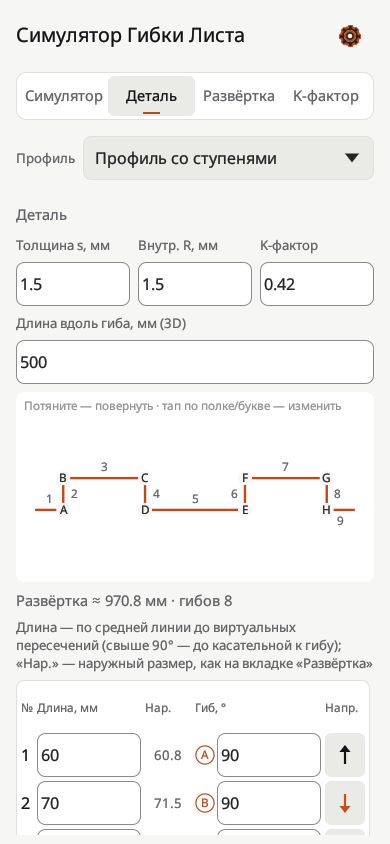
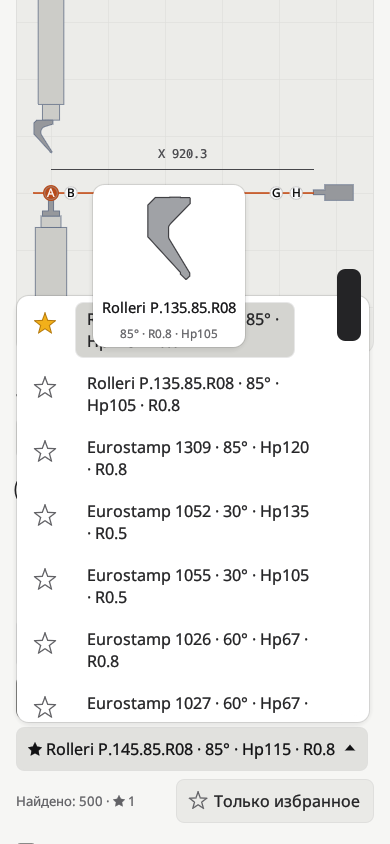
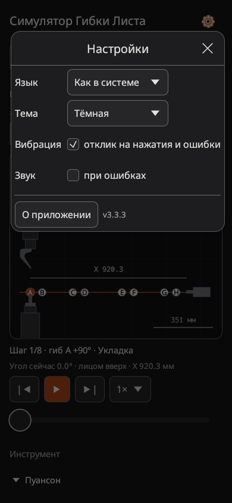

# Симулятор Гибки Листа

**Press Bending Simulating** — офлайн-симулятор листогибочного пресса для **Android** и **Windows**. Соберите деталь, подберите пуансон и матрицу, посмотрите каждый гиб в 2D и 3D, проверьте столкновения, рассчитайте развёртку и получите чертёж A4. Без интернета, регистрации и рекламы.

**Текущая версия: 3.4.2** · Android 8.0+ · Windows 10/11 x64 · русский и английский интерфейс

### [⬇️ Скачать 3.4.0](https://github.com/frikks/gibgib-sim/releases/latest) · [🌐 Сайт проекта](https://frikks.github.io/gibgib-sim/)

Сайт автоматически подтягивает версию, файлы и контрольные суммы из последнего релиза GitHub — при публикации нового релиза обновлять страницу вручную не нужно.

| Платформа | Готовый файл | Подробнее |
|---|---|---|
| **Android** | `GibGib-Sim-3.4.2-universal.apk` (или `.apks` для SAI/bundletool) | [Установка](#установка-android) |
| **Windows** | `GibGib-Sim-3.4.0-Windows-x64.exe` (или `.msix` + сертификат) | [windows/README.md](windows/README.md) |
| **Любая ОС (браузер)** | `GibGib-Sim-3.4.0.html` — полноценное приложение в одном файле, ~8,6 МБ | [Веб-версия](#веб-версия-340) |

> Исходный код не публикуется. Веб-сборка получена из того же кода 3.3.3.3, что и нативные сборки, и публикуется только готовым HTML-файлом.

### Веб-версия 3.4.0

Файл `GibGib-Sim-3.4.0.html` из релиза открывается двойным щелчком в любом браузере на Windows, macOS, Linux, Android и iOS — без установки и внешних файлов. Это **полная веб-версия**, собранная из исходного кода 3.3.3.3 в WebAssembly (Rust + eframe/egui), а не упрощённая страница. Работают вкладки «Проекты / Деталь / Гибка / Инструмент / Расчёт / Документы», 2D-сечение и 3D-вид с анимацией гибки, недогибы и пружинение, материалы, карта наладки, библиотека из 1000 инструментов, автоподбор, развёртка, K-фактор, чертёж A4, экспорт PDF/PNG/TXT/CSV/RTF, русский и английский языки.

SHA-256: `ab376799b5cc1cbe646569a1f9a8be3d36821bb42ccdd0720ee0d01feab09c71`.

Как и десктопная версия, она не управляет станком.

---

*Скриншоты демонстрируют интерфейс 3.3.3; в 3.4.0 добавлены нижние вкладки «Проекты · Деталь · Гибка · Инструмент · Расчёт · Документы».*

  
  
  
  
  

  

  

  

  

## Что нового в 3.4.0

Версия 3.4.0 — это бывшая тестовая сборка **3.3.3.3**, переведённая в статус стабильного релиза. Обе платформы теперь имеют единый номер версии и один репозиторий.

1. **Вкладки «Гибка» и «Инструмент» поменялись местами:** Проекты · Деталь · Гибка · Инструмент · Расчёт · Документы.
2. **Подбор перенесён на вкладку «Инструмент»**: кнопка «Подобрать инструмент и порядок», галочки «Подбор инструмента на деталь» и «Проверка/подбор доступности гиба», подсказка в блоке «Подбор и проверка гибки».
3. **Подбор порядка перебирает все углы недогиба** (½ угла, 30°, 45°, 60°): сначала выбранный, затем остальные. Найденный угол подставляется в «Недогиб».
4. **Честная быстрая проверка отвода пуансона** — больше не выдаёт «найдено 12 из 12», если полный порядок не проходит точную проверку.
5. **Подбор инструмента начинается с одноручьевых матриц**; двух- и четырёхручьевые (2V, 4V) рассматриваются только если одноручьевыми найти порядок не удалось.
6. Ранее в линейке 3.3.3.x: новые вкладки, проекты, карта наладки, пружинение, усилие, способы гибки, материалы и свой инструмент.

В исходном проекте — 71 автотест. Веб-сборка проверена запуском в браузере (все вкладки, 2D/3D и анимация гибки). EXE запущен и визуально проверен на Windows 11. APK 3.4.2 установлен и проверен пользователем на реальном телефоне: нижние кнопки в окне рисования профиля не перекрываются системной панелью. Подробности — в [CHANGELOG.md](CHANGELOG.md).

Что было в 3.3.3

- Списки пуансонов и матриц всегда 6–7 строк, широкая полоса прокрутки.
- Поиск инструмента системной клавиатурой, долгое нажатие — контур и размеры, фильтр «Только избранное».
- Печать (PDF A4) вкладок «Развёртка» и «K-фактор», кнопки и поля 44 px, текст 16 px.
- Иконка приложения на Windows — как на Android; экранный диктор и рамка фокуса.

Что было в 3.3 и 3.2

- 3.3: графитовые темы без синего оттенка, один оранжевый акцент, вкладки одной строкой, буквы гибов в кружках, иконки и размеры как линии чертежа. Редизайн по методике [unslop](https://github.com/heydamir/unslop).
- 3.2: чертёж A4 как в CAD (сечение, изометрия, развёртка, таблица гибов, основная надпись), автоподбор инструмента, избранное ⭐, `info_tools.txt`, подсветка невозможного гиба, меню «Настройки».

## Возможности

### 🔧 Деталь
- Готовые профили: уголок, уголок с подгибом, П/швеллер, C/короб, G-, Z/S-, омега-профиль, профиль со ступенями. «Ручной» профиль рисуется пальцем с выравниванием углов и длин.
- Толщина, внутренний R, K-фактор, длина вдоль гиба. Таблица полок с длинами, наружными размерами, углами 0–180° и направлением ↑↓.
- Объёмное превью вращается пальцем, двойной тап возвращает вид спереди.

### ▶️ Симулятор
- 2D-сечение и 3D-анимация каждого гиба: укладка, подвод пуансона, гибка, отвод, переустановка.
- Анимация плющения: подгиб до 150°, переход на подушку, плющение до 180°.
- Проверка столкновений с пуансоном, матрицей, траверсой, столом и задним упором; причина ошибки пишется словами.
- Перестановка операций, переворот детали, упор началом/концом, автоподбор порядка и инструмента.
- Настройка станка: ход отвода, зев до стойки, вылет упора, размеры держателей, зажима, стола и траверсы.

### 🗜 Инструмент — 500 пуансонов и 500 матриц
- 400 контуров производителей (294 по DXF, 106 восстановлены по PDF) и 600 параметрических профилей, включая 24 комплекта для подгибки и плющения.
- Поиск по производителю, коду, углу, радиусу и размерам; каждый ручей многоручьевой матрицы выбирается отдельно.
- ⭐ Избранный инструмент всегда наверху и участвует в подборе «по наличию».

### 📐 Развёртка и K-фактор
- Длина заготовки по наружным размерам: OSSB, припуск (BA), вычет (BD), прямые участки и координаты линий гиба.
- K-фактор по R/s или вручную, обратный расчёт по пробному гибу. Экспорт в TXT, CSV и RTF.

### 📄 Чертёж и документы
- Лист A4: сечение с размерами, изометрия, развёртка с линиями гиба, технические требования, таблица гибов и основная надпись.
- PDF (вектор) или PNG (200 dpi) и системная печать. `info_tools.txt` с данными инструмента и порядком гибов.

### 📱 Удобство
- Одна деталь для всех вкладок. Встроенная цифровая клавиатура для размеров, системная — для поиска инструмента.
- Язык, темы (системная, светлая, тёмная, AMOLED), вибрация на Android и звук ошибок на Windows. Нативное приложение на Rust с графикой OpenGL ES.

## Установка (Android)

1. Откройте [релиз v3.4.0](https://github.com/frikks/gibgib-sim/releases/tag/v3.4.0).
2. Скачайте `GibGib-Sim-3.4.2-universal.apk` и откройте его на телефоне.
3. Разрешите установку из этого источника, если Android спросит, и нажмите «Установить».

Новые версии ставятся поверх старых, данные сохраняются. Файл `.apks` — тот же APK, разделённый по типам процессоров; ставится через [SAI](https://github.com/Aefyr/SAI) или `adb install-multiple`. Если не уверены — берите `universal.apk`.

Установка и настройка Windows-версии описаны в [windows/README.md](windows/README.md).

## Контрольные суммы SHA-256

APK/APKS 3.4.2 пересобраны с исправлением нижних кнопок Android и подписаны тем же ключом. EXE/MSIX/CER — неизменённые бинарники 3.3.3.3. Веб-версия пересобрана из того же исходника и имеет собственный SHA-256.

| Файл | SHA-256 |
|---|---|
| `GibGib-Sim-3.4.2-universal.apk` | `1bda6681ad575b1da398ddb1a6fa432f0918f75395f44e5e4b0a585dc52380a9` |
| `GibGib-Sim-3.4.2.apks` | `af410bf1cc3e3855f7ec7639f23027bd27cf3b45a8662ed287db1660798527f2` |
| `GibGib-Sim-3.4.0-Windows-x64.exe` | `8339e3b04f2afe5f72521c2c958a2f17c3c7cfed42ac2d99f75798df206467fb` |
| `GibGib-Sim-3.4.0-Windows11-x64-TEST.msix` | `876128c7a61b544cb6680fe34fd4617051f5c697c8eecc0b49c54b88e286e1e3` |
| `GibGib-Sim-Windows-TEST-2026.cer` | `404bc3395192697c78c3c9d32d41aef8920c52a4f01ca898eec7e5812d7364f4` |
| `GibGib-Sim-3.4.0.html` | `ab376799b5cc1cbe646569a1f9a8be3d36821bb42ccdd0720ee0d01feab09c71` |

Проверить: `Get-FileHash <файл> -Algorithm SHA256` (PowerShell) или `sha256sum <файл>` (Linux/macOS).

## Конфиденциальность

Приложение не запрашивает доступ к интернету, ничего не отправляет и не содержит рекламы. На Android единственное разрешение — вибрация. Детали и настройки хранятся только локально; отчёты и чертежи сохраняются через системный диалог туда, куда вы выберете.

## Ограничения

Учебно-справочный инструмент для технологов, операторов и студентов. Он не заменяет CAD/CAM и не управляет станком. Усилие гибки, пружинение и допуски не рассчитываются; 106 контуров восстановлены приближённо, 600 типовых не являются чертежами производителей; автоподбор порядка ограничен по времени. Перед работой на станке сверяйте инструмент и последовательность гибов с реальными чертежами.

Названия производителей инструмента приведены только для идентификации и являются товарными знаками их владельцев.

## Обратная связь

Ошибки и предложения — во вкладке [Issues](https://github.com/frikks/gibgib-sim/issues) или в Telegram [@Frikks](https://t.me/Frikks).

## Лицензия

© 2026 [@Frikks](https://t.me/Frikks). Все права защищены, исходный код не публикуется. Бесплатное скачивание и использование официальных сборок разрешены; копирование, распространение, изменение и форки — только с письменного разрешения автора. См. [LICENSE](LICENSE) и [лицензии сторонних компонентов](windows/THIRD-PARTY-LICENSES.txt).

---

## English

**Press Bending Simulating** is an offline press brake simulator for **Android, Windows and any browser**. Build a sheet metal part, pick a punch and die, watch every bend in 2D and 3D, check collisions, calculate the flat pattern (OSSB, BA, BD), get a K-factor and export an A4 drawing as PDF/PNG. No internet, no ads, RU/EN interface.

- 500 punches + 500 dies (400 manufacturer contours, 24 hemming sets), favourites and automatic selection.
- Bending/hemming animation, collision checks, automatic bend sequence search, machine setup.
- Projects, tooling map, springback, bending force, custom tooling and all under-bend angles were added in the 3.3.3.x line.
- **3.4.0** promotes the tested 3.3.3.3 build to a stable release with a single version number for all platforms.
- **Web edition:** `GibGib-Sim-3.4.0.html` is the full application compiled from the 3.3.3.3 source to WebAssembly (Rust + eframe/egui). Open the file in any browser on Windows, macOS, Linux, Android or iOS — no installation. SHA-256: `ab376799b5cc1cbe646569a1f9a8be3d36821bb42ccdd0720ee0d01feab09c71`.
- **Windows:** run the unsigned `GibGib-Sim-3.4.0-Windows-x64.exe` without installation, or install the MSIX package with the test certificate (see [windows/README.md](windows/README.md) for the PowerShell commands and certificate thumbprint).

Native files are the unchanged 3.3.3.3 binaries renamed for the stable release; the web edition was rebuilt from source and has its own checksum. The source code is not published; only the finished HTML file is distributed.

The web build was smoke-tested in a browser, the Windows EXE was launched and visually checked on Windows 11, and APK 3.4.2 was installed and checked by the author on a real phone (the bottom buttons in the profile drawing dialog are no longer covered by the system bar). This is an educational tool, not a machine control or safety system. © 2026 @Frikks. All rights reserved. See [LICENSE](LICENSE).
