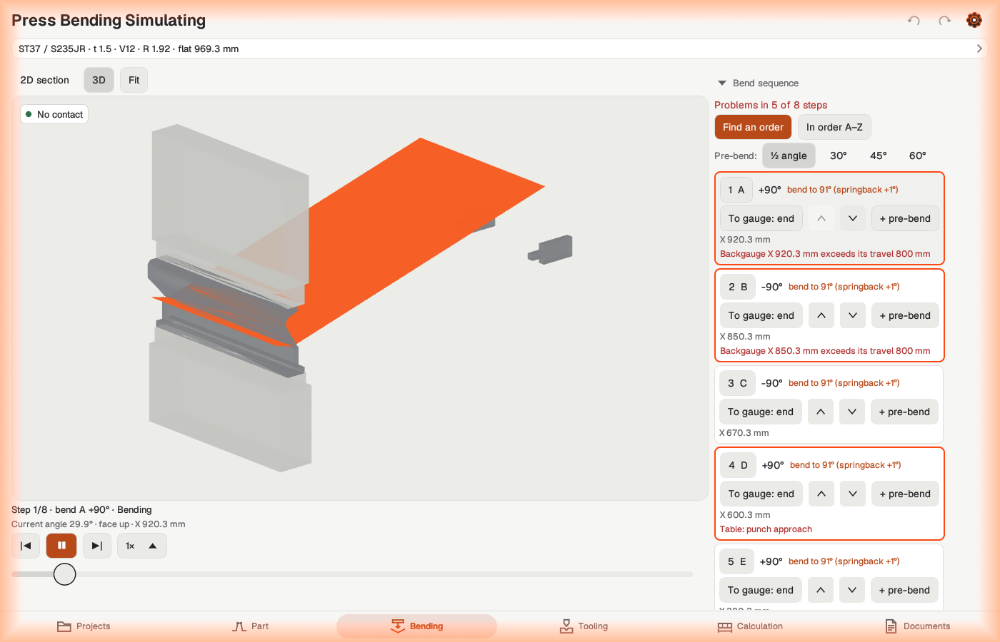
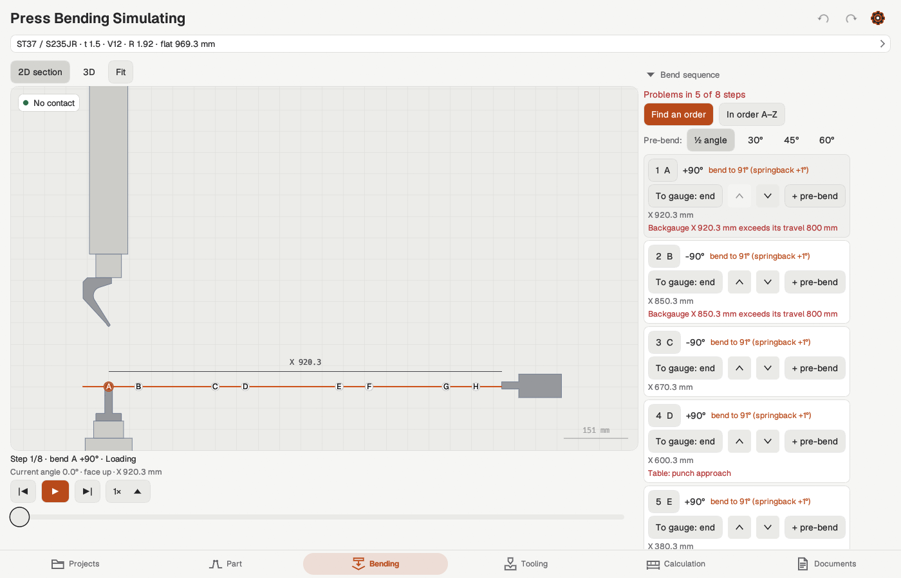
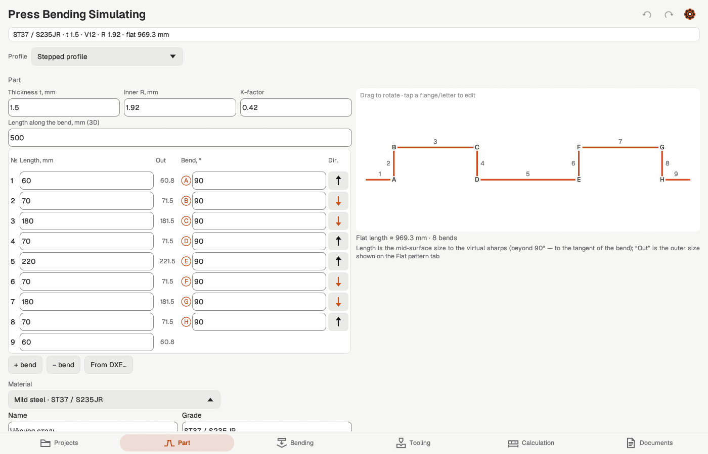
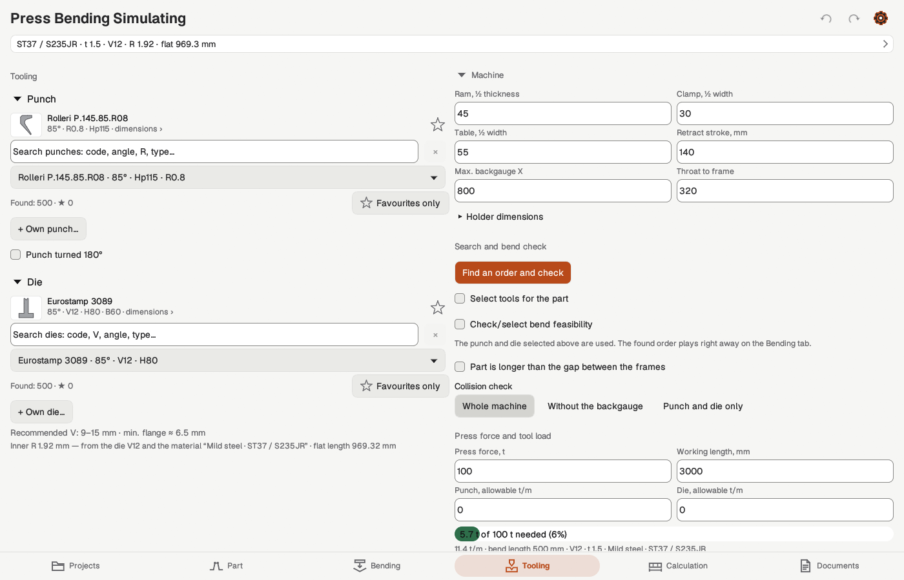
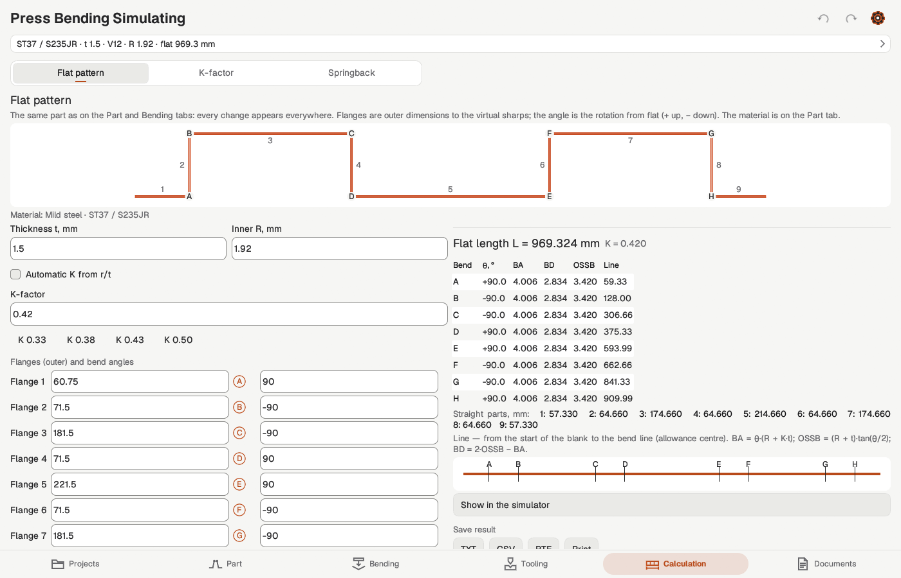
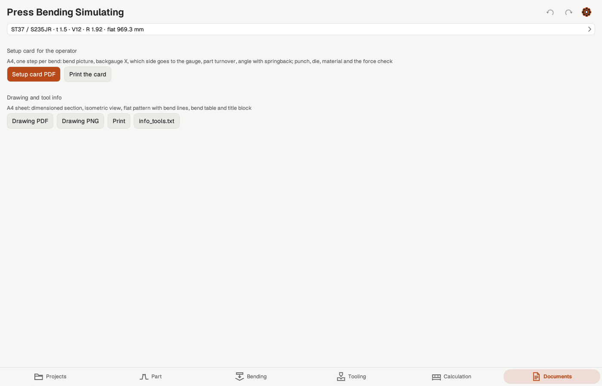
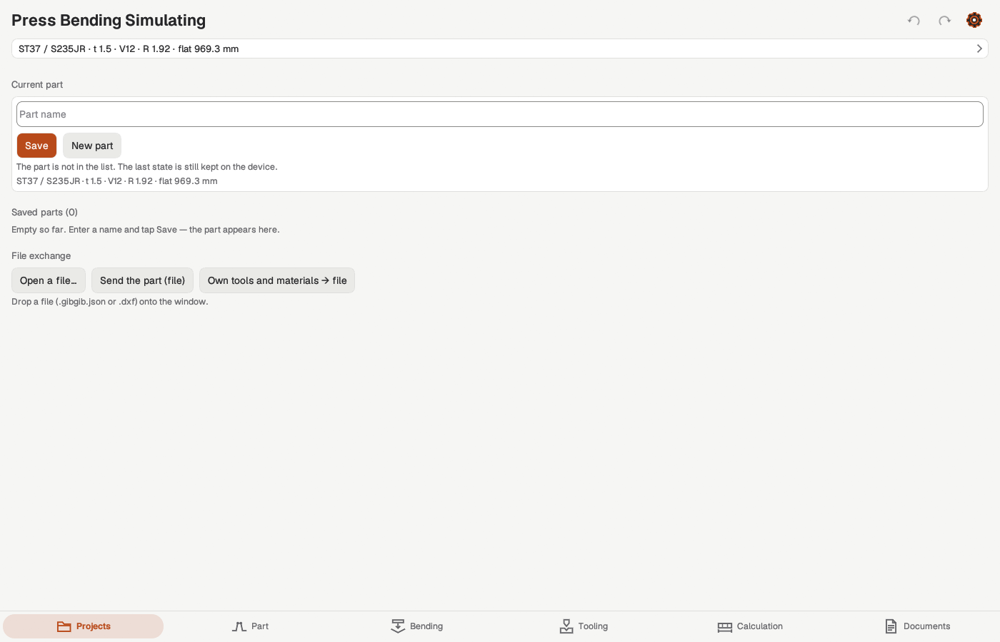
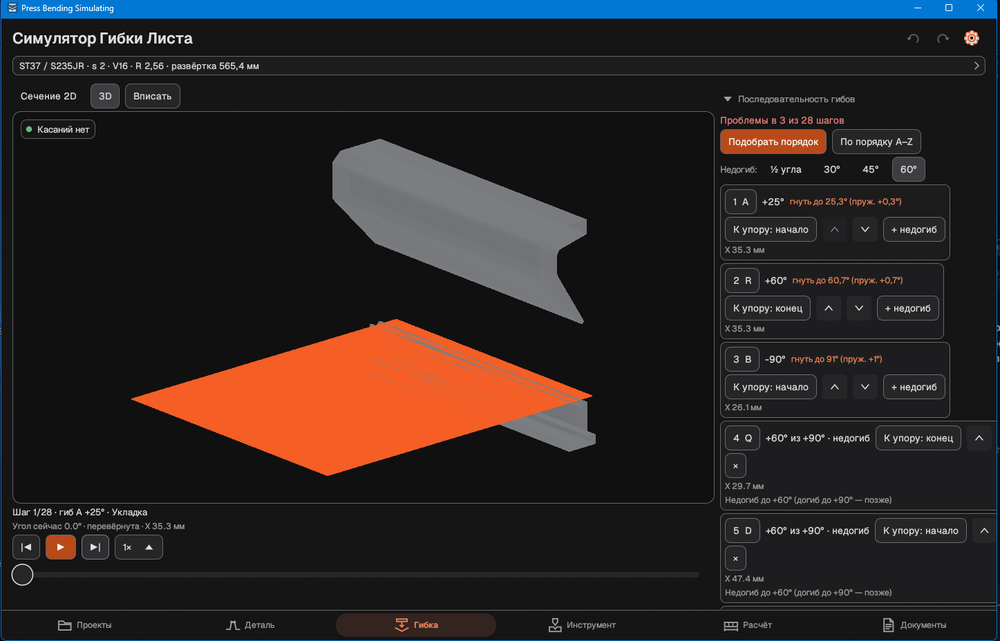

# Симулятор Гибки Листа

**Press Bending Simulating — офлайн-симулятор листогибочного пресса для Android, Windows и браузера**

**Деталь → гибка → развёртка → чертёж A4 · 500 пуансонов + 500 матриц · без интернета и регистрации**

[Возможности](#возможности) · [Как это работает](#как-это-работает) · [Скриншоты](#скриншоты) · [Скачать](#скачать) · [English](#english)

---

## Возможности

### Деталь

- Готовые профили: уголок, уголок с подгибом, П-профиль / швеллер, C-профиль / короб, G-, Z/S- и омега-профили, профиль со ступенями.
- «Ручной» профиль рисуется пальцем: углы выравниваются до 45° или 5°, длины — до 5 мм; тап по полке или букве задаёт точное значение.
- Толщина, внутренний R, K-фактор и длина вдоль гиба; таблица полок с длинами, наружными размерами, углами 0–180° и направлением ↑↓.
- Объёмное превью вращается пальцем, двойной тап возвращает вид спереди.

### Гибка

- 2D-сечение и 3D-анимация каждого гиба: укладка, подвод пуансона, гибка, отвод, переустановка.
- Анимация подгибки и плющения: подгиб до 150°, переход на подушку, плющение до 180°.
- Проверка столкновений с пуансоном, матрицей, траверсой, столом и задним упором — причина пишется словами.
- Недогибы (½ угла, 30°, 45°, 60°), пружинение, предлагаемые способы гибки и карта наладки.
- Перестановка операций, переворот детали, упор началом/концом.
- Автоподбор порядка гибов и инструмента одной кнопкой; невозможный гиб подсвечивается и переводит к проблемному шагу.
- Настройка станка: ход отвода, зев до стойки, вылет упора, размеры держателей, зажима, стола и траверсы.

### Инструмент — 500 пуансонов и 500 матриц

- 400 контуров производителей: 294 по чертежам DXF, 106 восстановлены приближённо по PDF.
- 600 параметрических профилей, включая 24 комплекта для подгибки и плющения.
- Поиск по производителю, коду, углу, радиусу и размерам; каждый ручей многоручьевой матрицы выбирается отдельно.
- ★ Избранный инструмент всегда наверху и участвует в подборе «по наличию».
- Свой инструмент: шаблон с размерами, контур пальцем или импорт ASCII DXF.

### Развёртка и K-фактор

- Длина заготовки по наружным размерам: OSSB, припуск BA, вычет BD, прямые участки и координаты линий гиба.
- K-фактор по R/s или вручную, обратный расчёт по пробному гибу.
- Экспорт в TXT, CSV и RTF.

### Чертёж и документы

- Лист A4: сечение с размерами, 3D-изометрия, развёртка с линиями гиба, технические требования, таблица гибов и основная надпись.
- Сохранение в PDF (вектор) или PNG (200 dpi), печать через системный диалог.
- `info_tools.txt` с полными данными пуансона, матрицы и порядком гибов.

### Интерфейс

- Вкладки «Проекты · Деталь · Гибка · Инструмент · Расчёт · Документы».
- Одна деталь общая для всех вкладок: изменения сразу видны везде.
- Встроенная цифровая клавиатура для размеров, системная — для поиска инструмента.
- Русский и английский языки; темы системная, светлая, тёмная, AMOLED; вибрация на Android и звук ошибки на Windows.
- Экранный диктор и рамка фокуса на Windows.

---

## Как это работает

1. **Соберите деталь** из готового профиля или нарисуйте свою.
2. **Выберите инструмент** вручную или авто подбором по библиотеке.
3. **Запустите симуляцию** — посмотрите каждый гиб в 2D/3D и проверьте столкновения.
4. **Откройте развёртку** — получите длину заготовки и K-фактор.
5. **Экспортируйте** чертёж A4, отчёт и данные для оператора.

---

## Скриншоты

| 3D-гибка | 2D-сечение |
| :---: | :---: |
|  |  |

| Деталь | Инструмент |
| :---: | :---: |
|  |  |

| Расчёт | Документы |
| :---: | :---: |
|  |  |

| Проекты | Windows: десктоп |
| :---: | :---: |
|  |  |

Скриншоты сняты с веб- и Windows-сборок 3.4.3.

---

## Скачать

| Платформа | Файл | Как запустить |
| :--- | :--- | :--- |
| **Android 8+** | [universal.apk](https://github.com/frikks/gibgib-sim/releases/latest/download/GibGib-Sim-3.4.3-universal.apk) · [.apks](https://github.com/frikks/gibgib-sim/releases/latest/download/GibGib-Sim-3.4.3.apks) | Открыть APK на телефоне. `.apks` — через [SAI](https://github.com/Aefyr/SAI) или `adb install-multiple`. |
| **Windows 10/11 x64** | [EXE](https://github.com/frikks/gibgib-sim/releases/latest/download/GibGib-Sim-3.4.3-Windows-x64.exe) · [MSIX](https://github.com/frikks/gibgib-sim/releases/latest/download/GibGib-Sim-3.4.3-Windows11-x64-TEST.msix) · [CER](https://github.com/frikks/gibgib-sim/releases/latest/download/GibGib-Sim-Windows-TEST-2026.cer) | EXE запускается без установки; для MSIX нужен тестовый сертификат — инструкция в [windows/README.md](windows/README.md). |
| **Браузер** | [HTML](https://github.com/frikks/gibgib-sim/releases/latest/download/GibGib-Sim-3.4.3.html) | Скачать файл и открыть двойным щелчком. Работает офлайн на Windows, macOS, Linux, Android и iOS. |

Контрольные суммы SHA-256: **[SHA256SUMS.txt](https://github.com/frikks/gibgib-sim/releases/latest/download/SHA256SUMS.txt)** · [все релизы](https://github.com/frikks/gibgib-sim/releases) · [сайт проекта](https://frikks.github.io/gibgib-sim/).

Сайт автоматически подтягивает версию, файлы и хеши из последнего релиза — обновлять его вручную не нужно.

### Что нового в 3.4.x

- **3.4.3** — устойчивый импорт DXF: дублированные линии и микроскопические смещения (~0,001 мм) больше не мешают открытию сечения детали.
- **3.4.2** — исправлено перекрытие нижних кнопок системной панелью Android; APK проверен на реальном телефоне.
- **3.4.1 / 3.4.0** — единый репозиторий и единая нумерация для Android, Windows и веб-версии; полная веб-сборка на WebAssembly; обновлённая лицензия.

Подробнее — в [CHANGELOG.md](CHANGELOG.md).

---

## Конфиденциальность и ограничения

Приложение не запрашивает доступ к интернету, ничего не отправляет и не содержит рекламы. Единственное разрешение на Android — вибрация. Детали и настройки хранятся локально; отчёты и чертежи сохраняются через системный диалог.

Это учебно-справочный инструмент для технологов, операторов и студентов. Он не заменяет CAD/CAM и не управляет станком. Усилие гибки, пружинение и допуски не рассчитываются; 106 контуров восстановлены приближённо. Перед работой на станке сверяйте инструмент и последовательность гибов с реальными чертежами.

Названия производителей инструмента приведены только для идентификации и являются товарными знаками их владельцев.

---

## Ссылки

- [История версий](CHANGELOG.md)
- [Инструкция для Windows](windows/README.md)
- [Как собрать веб-версию](docs/BUILD.md)
- [Все релизы](https://github.com/frikks/gibgib-sim/releases)
- [Сообщить об ошибке](https://github.com/frikks/gibgib-sim/issues)
- Автор: [@Frikks](https://t.me/Frikks)

Исходный код не публикуется. Бесплатное скачивание и использование официальных сборок разрешены; копирование, распространение, изменение и форки — только с письменного разрешения автора. См. [LICENSE](LICENSE) и [лицензии сторонних компонентов](windows/THIRD-PARTY-LICENSES.txt).

---

## English

**Press Bending Simulating** is an offline press brake simulator for **Android, Windows and any browser**. Build a sheet metal part, pick a punch and die, watch every bend in 2D and 3D, check collisions, calculate the flat pattern (OSSB, BA, BD), get a K-factor and export an A4 drawing as PDF/PNG. No internet, no ads, RU/EN interface.

- 500 punches + 500 dies, favourites and automatic selection; custom tooling from ASCII DXF.
- Bending/hemming animation, collision checks, bend sequence search, springback, machine setup.
- Projects, tooling map, material settings and all under-bend angles in 3.3.3.x; DXF import hardened in 3.4.3.
- **Web edition:** the same Rust code compiled to WebAssembly, packed into one HTML file that opens offline in any browser.

[Download](https://github.com/frikks/gibgib-sim/releases/latest) · [Website](https://frikks.github.io/gibgib-sim/) · [Changelog](CHANGELOG.md) · [SHA-256 sums](https://github.com/frikks/gibgib-sim/releases/latest/download/SHA256SUMS.txt)

This is an educational tool, not a machine control or safety system. © 2026 @Frikks. All rights reserved. See [LICENSE](LICENSE).
