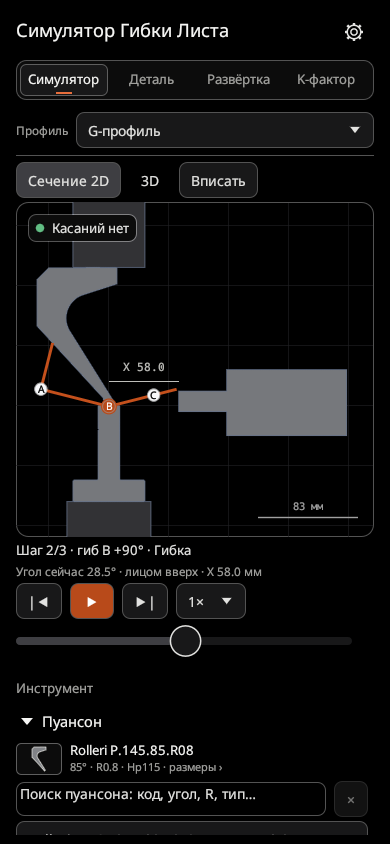
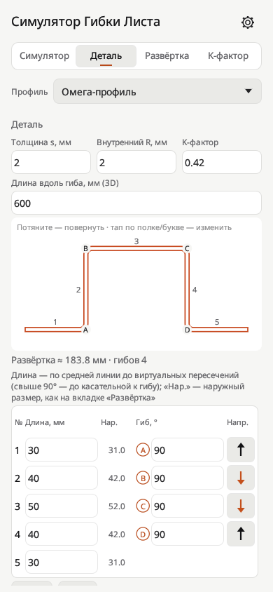
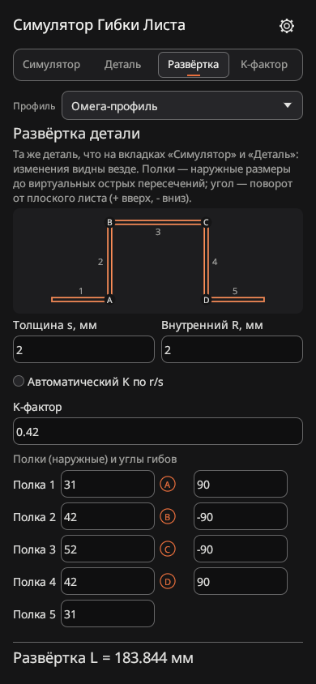
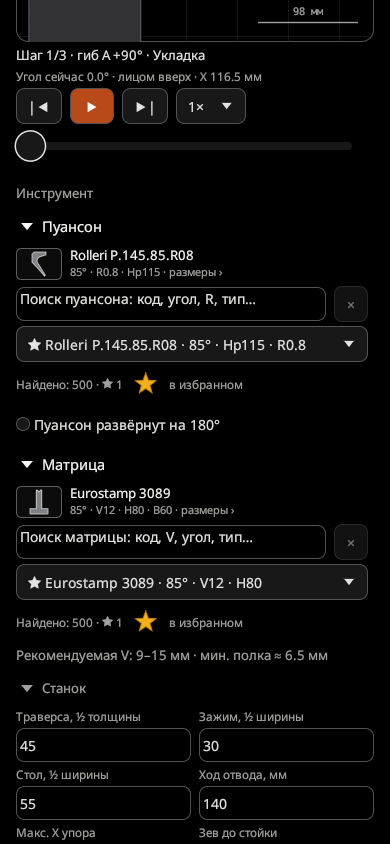
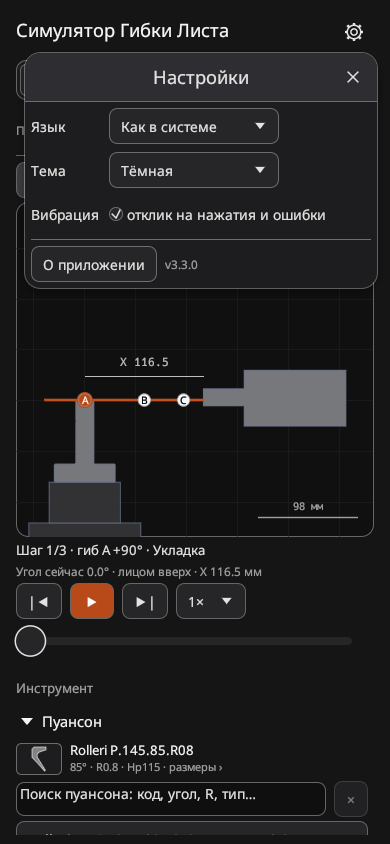
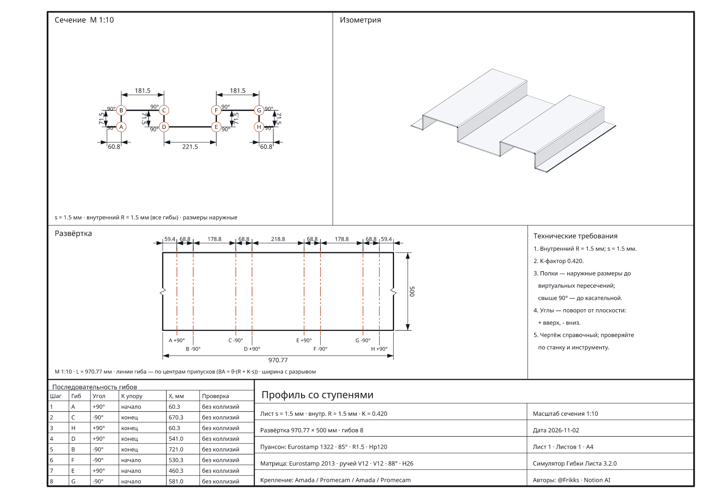

# Симулятор Гибки Листа

**Офлайн-симулятор листогибочного пресса для Android.** Соберите деталь, подберите пуансон и матрицу (вручную или автоматически), посмотрите каждый гиб в 2D и 3D, проверьте столкновения, рассчитайте развёртку и получите чертёж A4.

### [⬇️ Скачать последнюю версию](../../releases/latest)

Android 8.0+ · без интернета и регистрации · русский и английский интерфейс · [версия для Windows](https://github.com/frikks/gibgib-sim-windows/releases/latest)

  
  
  
  
  

  

  

## Что нового в 3.3
- 🎨 **Новый внешний вид.** Графитовые темы без синего оттенка (светлая, тёмная, AMOLED) и один акцент — сигнальный оранжевый: деталь, главная кнопка, выбранная вкладка.
- Вкладки одной строкой — больше места для окна симуляции.
- Инструмент и станок стальные серые, размеры — как линии чертежа; статус касания — плашка с цветной точкой.
- Буквы гибов A, B, C… в кружках — одинаково в симуляции и в таблицах.
- Кнопки и поля 36 px, отступы по сетке 4 px, подписи разделов обычными буквами.
- Расчёты, библиотека, чертёж и файлы не менялись. Редизайн — по методике [unslop](https://github.com/heydamir/unslop).

Что было в 3.2

- 📐 **Чертёж A4 как в CAD** — сечение с размерами, изометрия, развёртка с линиями гиба, таблица гибов, основная надпись. Сохранение в PDF или PNG и печать с телефона.
- 🤖 **Автоподбор инструмента** — по всей библиотеке (500 + 500) или только по избранному ⭐ «в наличии».
- ⭐ **Избранный инструмент** — звезда в списках пуансонов и матриц, отмеченные всегда наверху.
- 📄 **info_tools.txt** — пуансон, матрица и порядок гибов для оператора.
- 🚨 **Невозможный гиб** — свечение краёв, вибрация в такт и переход к проблемному шагу.
- ⚙️ **Меню «Настройки»** — язык, тема, вибрация, «О приложении». 📳 Вибрация на нажатия, ввод и ошибки.
- 🔧 Исправлены сохранение TXT/CSV/RTF и «слипание» текста на части телефонов; таблица полок в 5 столбцов; «Внутренний R» вместо «Rвн».

## Возможности

### 🔧 Деталь
- Готовые профили: уголок, уголок с подгибом (плющение), П-профиль / швеллер, C-профиль / короб, G-, Z/S- и омега-профили, профиль со ступенями.
- «Ручной» профиль можно нарисовать пальцем. Углы выравниваются до 45° или 5°, длины округляются до 5 мм.
- Толщина, внутренний R, K-фактор и длина вдоль гиба. Таблица полок: длина, наружный размер, угол от 0° до 180° и направление стрелкой ↑↓.
- Наружные размеры показаны рядом с размерами по средней линии.
- Объёмное превью детали вращается пальцем, двойной тап возвращает вид спереди.

### ▶️ Симулятор
- Сечение 2D и 3D-вид с анимацией каждого гиба: укладка, подвод пуансона, гибка, отвод, переустановка.
- Анимация плющения для комплектов подгибки: подгиб до 150°, переход на подушку, плющение до 180°.
- Проверка столкновений детали с пуансоном, матрицей, траверсой, столом и задним упором. Ошибка подсвечивается красным, причина пишется словами.
- Если подгиб нельзя закрыть выбранным инструментом, анимация не запускается и появляется подсказка, какой комплект нужен.
- Перестановка операций, переворот детали, упор началом или концом.
- Автоподбор порядка гибов одной кнопкой; автоподбор пуансона и матрицы по всей библиотеке или по избранному.
- Если гиб невозможен — свечение краёв, вибрация и переход к проблемному шагу в «Последовательности гибов».
- Настройка станка: ход отвода, зев до стойки, вылет упора, размеры держателей, зажима, стола и траверсы.

### 🗜 Инструмент — 500 пуансонов и 500 матриц
- 400 контуров инструмента производителей: 294 по чертежам DXF, 106 восстановлены приближённо по PDF.
- 600 типовых параметрических профилей, из них 24 комплекта для подгибки и плющения.
- Поиск по производителю, коду, углу, радиусу и размерам.
- У многоручьевых матриц каждый ручей выбирается отдельно. У каждого инструмента есть чертёж с размерами.
- ⭐ Избранное: отметьте инструмент, который есть в цеху, — он всегда наверху списка и используется в подборе «по наличию».

### 📐 Развёртка и K-фактор
- Длина заготовки по наружным размерам: отступ до касательной (OSSB), припуск (BA) и вычет (BD) на гиб, прямые участки, координаты линий гиба.
- K-фактор автоматически по R/s или вручную; обратный расчёт K по пробному гибу.
- Сохранение результатов в TXT, CSV и RTF.

### 📄 Чертёж и документы
- Чертёж детали на листе A4: 2D-сечение с размерами, 3D-изометрия, развёртка с линиями гиба, технические требования, таблица последовательности гибов и основная надпись.
- Сохранение в PDF (вектор) или PNG (200 dpi), печать через системную печать Android.
- Файл info_tools.txt с полными данными пуансона, матрицы и порядком гибов.

### 📱 Удобство
- Одна деталь для всех вкладок: изменения сразу видны везде.
- Встроенная цифровая клавиатура для ввода размеров.
- Меню «Настройки» (шестерёнка справа вверху): язык, тема (системная, светлая, тёмная, AMOLED), вибрация, «О приложении».
- Вибрация на нажатия, ввод значений и ошибки (отключается).
- Нативное приложение на Rust с графикой OpenGL ES.

## Установка

1. Откройте страницу [последнего релиза](../../releases/latest).
2. В разделе **Assets** скачайте файл `GibGib-Sim-…-universal.apk`.
3. Откройте скачанный файл на телефоне. Если Android спросит, разрешите установку из этого источника (браузера или файлового менеджера).
4. Нажмите «Установить».

Новые версии устанавливаются поверх старых, данные сохраняются.

Файл `.apks` — тот же APK, разделённый по типам процессоров (на телефоне занимает меньше места). Его нужно ставить через [SAI (Split APKs Installer)](https://github.com/Aefyr/SAI) или `adb install-multiple`. Если не уверены — берите `universal.apk`.

Контрольные суммы SHA-256 файлов указаны на странице каждого релиза.

## Конфиденциальность
Приложение не запрашивает доступ к интернету, ничего не отправляет и не содержит рекламы. Единственное разрешение — вибрация. Детали и настройки хранятся только во внутренней памяти приложения. Отчёты и чертежи сохраняются через системный диалог Android туда, куда вы выберете.

## Ограничения
Это учебно-справочный инструмент для технологов, операторов и студентов. Он не заменяет CAD/CAM и систему управления станком.
- Усилие гибки, пружинение и допуски не рассчитываются.
- Контуры инструмента упрощены; 106 контуров восстановлены приближённо, 600 типовых не являются чертежами производителей.
- Автоподбор порядка гибов ограничен по времени и не гарантирует решение для сложных деталей.

Перед работой на станке сверяйте инструмент, посадки, зажимы и последовательность гибов с реальными чертежами.

Названия производителей инструмента приведены только для идентификации и являются товарными знаками их владельцев.

## Обратная связь
Ошибки и предложения — во вкладке [Issues](../../issues) или в Telegram [@Frikks](https://t.me/Frikks).

## Лицензия
© 2026 [@Frikks](https://t.me/Frikks). Все права защищены. Исходный код не публикуется.

Можно бесплатно скачивать официальный APK с этой страницы и пользоваться им. Копировать и выкладывать приложение на других сайтах и в магазинах, изменять его, создавать производные версии и использовать материалы этого репозитория (в том числе через форки) можно только с письменного разрешения автора. Подробнее — в файле [LICENSE](LICENSE).

## Авторы
[@Frikks](https://t.me/Frikks) · Notion AI

---

## English

**Press Bending Simulating** is an offline press brake simulator for Android. Build a sheet metal part, pick a punch and die, watch every bend in 2D and 3D, check collisions and calculate the flat pattern.

- Profiles: angle, hemmed angle, U/channel, C, G, Z/S, omega, stepped profile, or draw your own with a finger.
- Bending and hemming (flattening) animation up to 180°, collision checks, automatic bend sequence search.
- 500 punches and 500 dies, including 24 hemming sets.
- Automatic punch + die selection from the whole library or from your ⭐ favourites.
- A4 drawing (section with dimensions, isometric view, flat pattern, bend table, title block) as PDF/PNG and printing; info_tools.txt for the operator.
- Flat pattern (OSSB, BA, BD), K-factor from a test bend, export to TXT, CSV and RTF.
- Settings menu (language, light/dark/AMOLED theme, haptics). No internet permission, no ads.
- 3.3: redesigned interface — graphite themes, one signal-orange accent, one-row tabs, ringed bend letters, larger touch targets.

[Download the latest release](../../releases/latest) · Android 8.0+ · Windows version: [gibgib-sim-windows](https://github.com/frikks/gibgib-sim-windows/releases/latest)

This is an educational tool, not a machine safety system. Always verify tooling and bend sequences against real drawings.

© 2026 @Frikks. All rights reserved. The source code is not published. Redistribution, modification and forks require the author's written permission. See [LICENSE](LICENSE).
