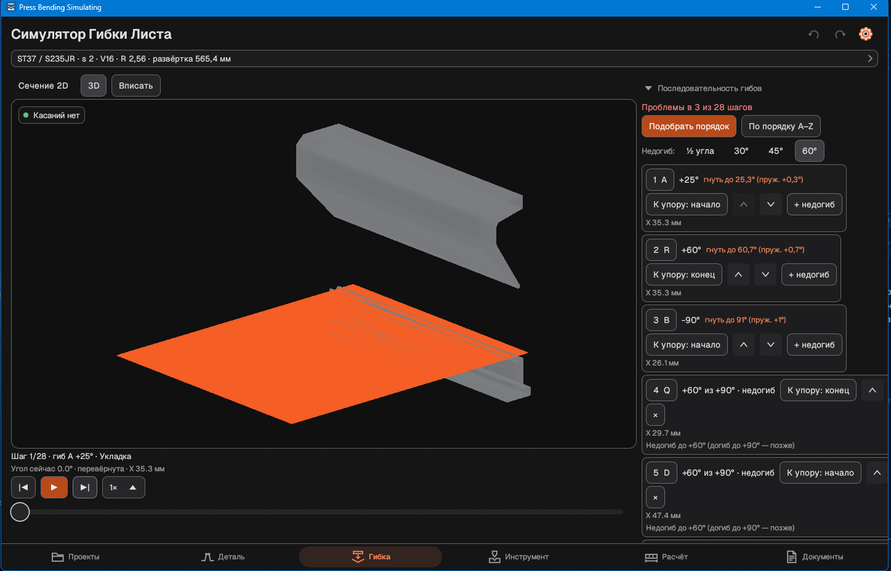

# Симулятор Гибки Листа — Windows

Windows-версия офлайн-симулятора листогибочного пресса. С 3.4.0 документация Android и Windows объединена в одном репозитории; этот файл описывает только особенности Windows-сборки.

[⬇️ Скачать Windows-версию 3.4.3](https://github.com/frikks/gibgib-sim/releases/latest) · [Общий README и возможности](../README.md) · [История версий](../CHANGELOG.md)

## Файлы и совместимость

| Файл | Назначение | SHA-256 |
|---|---|---|
| `GibGib-Sim-3.4.3-Windows-x64.exe` | Запуск без установки, 64-битные Windows 10 и 11. EXE не подписан. | `8339e3b04f2afe5f72521c2c958a2f17c3c7cfed42ac2d99f75798df206467fb` |
| `GibGib-Sim-3.4.3-Windows11-x64-TEST.msix` | Тестовый установочный пакет для Windows 11 x64; нужен сертификат ниже. | `98cbadfa95e0f754fae70347235d1e4f700a7ef0c762d62e03cf301ba699de44` |
| `GibGib-Sim-Windows-TEST-2026.cer` | Открытый тестовый сертификат для MSIX. | `578ce2a4a3ada203f21e948bd7137daa409fb3e7feba79fb47a33342c651e405` |

Предыдущие сборки проверены пользователем на Windows 11 Pro 26H1, сборка 28000.2704. Сборка 3.4.3 — тот же бинарник 3.3.3.3, переименованный для стабильного релиза; он прошёл 71 автотест и визуальную проверку в окне 1280×900; запуск на реальной Windows подтверждён пользователем для предыдущих версий. Windows 7/8, 32-битная и ARM Windows этой сборкой не поддерживаются.

**Проще всего:** скачайте EXE и запустите его. Если Windows покажет «Windows защитила компьютер» → «Подробнее» → «Выполнить в любом случае». Установка и сертификат в этом случае не нужны.

## Установка MSIX

Пакет подписан **самоподписанным тестовым сертификатом**, а не сертификатом проверенного издателя. Установка требует добавления сертификата в доверенные хранилища. Доверяйте ему только если понимаете риск: тот же ключ может подписывать и другие пакеты. Для тестирования проще выбрать EXE.

1. Скачайте MSIX и CER в одну папку. Сверьте SHA-256 CER: `404BC3395192697C78C3C9D32D41AEF8920C52A4F01CA898EEC7E5812D7364F4`.
2. Откройте PowerShell **от имени администратора** в этой папке:

```powershell
Import-Certificate -CertStoreLocation "Cert:\LocalMachine\TrustedPeople" -FilePath ".\GibGib-Sim-Windows-TEST-2026.cer"
Add-AppxPackage ".\GibGib-Sim-3.4.3-Windows11-x64-TEST.msix"
```

Пакет 3.4.3 подписан **новым** тестовым самоподписанным сертификатом (27.11.2026), отпечаток SHA-1 `9DB5AD8D3DE8E300B75D29A00F7812E371A41EA4`. Старый сертификат `AFAE91781197A5135DBE4F51FD05E02ED8C93044` больше не подходит — установите новый CER из релиза и доверьте ему. Обновление поверх версий с другим сертификатом не проверялось, поэтому перед заменой сохраните данные и резервную копию. После тестирования доверие можно отозвать, удалив новый сертификат из хранилища «Доверенные пользователи» локального компьютера.

## Особенности Windows-версии

- Вкладки «Деталь», «Развёртка» и «K-фактор» адаптируются к ширине окна: на широких экранах — две колонки, в узких — вертикальная прокрутка.
- Кнопка «Печать» создаёт PDF A4 для печати в другой программе.
- Экспорт отчётов в TXT, CSV и RTF; `info_tools.txt` для оператора.
- Экранный диктор (Windows, NVDA) и рамка фокуса при работе с клавиатуры; Esc закрывает списки и окна по очереди.
- Вместо вибрации — звук ошибки, по умолчанию выключен; включается в ⚙ «Настройки» → «Звук — при ошибках».
- Настройки: `%LOCALAPPDATA%\GibGib-Sim`. Экспорт: `Documents\GibGib-Sim` профиля пользователя (при недоступности — текущая папка). Для установленного MSIX Windows может перенаправлять пути в контейнер пакета.

## Экраны

*Снимок десктопной сборки 3.4.3 на Windows 11.*

<p align="center">
  
</p>

Остальные экраны (2D/3D, деталь, инструмент, развёртка, документы) — в [общем README](../README.md#скриншоты).

## Важно

Расчёты справочные: приложение не управляет станком и не подтверждает безопасность гибки. Всегда проверяйте инструмент и последовательность по документации оборудования.

© 2026 [@Frikks](https://t.me/Frikks). Все права защищены. Условия использования — [LICENSE](../LICENSE). Лицензии сторонних компонентов — [THIRD-PARTY-LICENSES.txt](THIRD-PARTY-LICENSES.txt).
